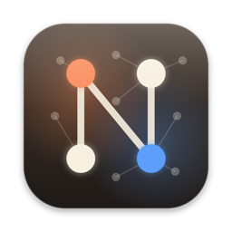
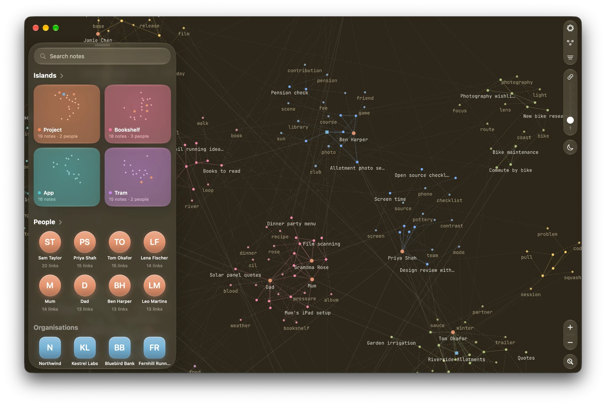
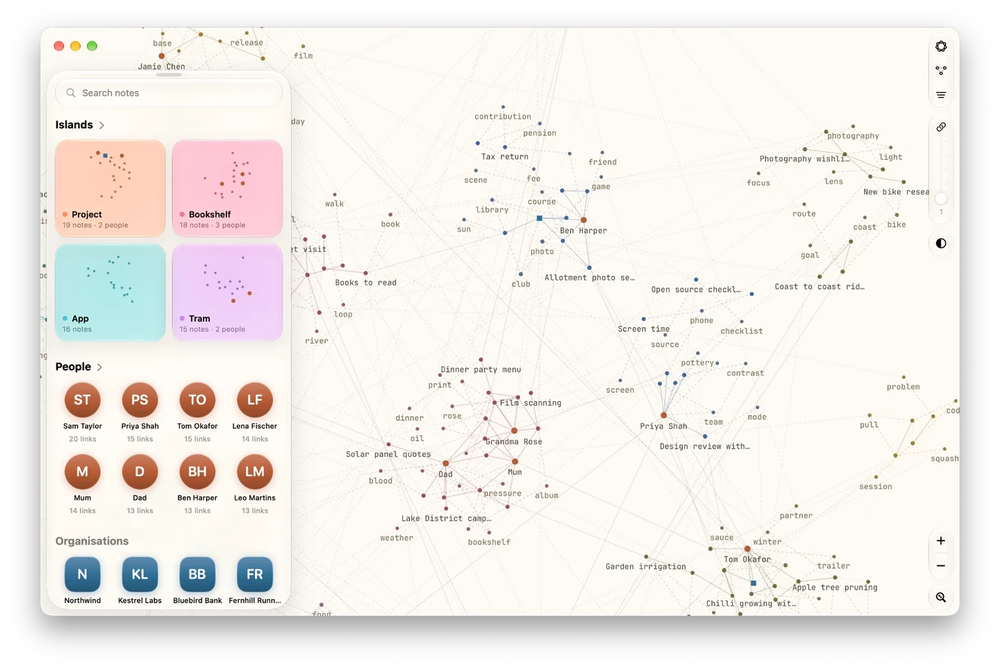
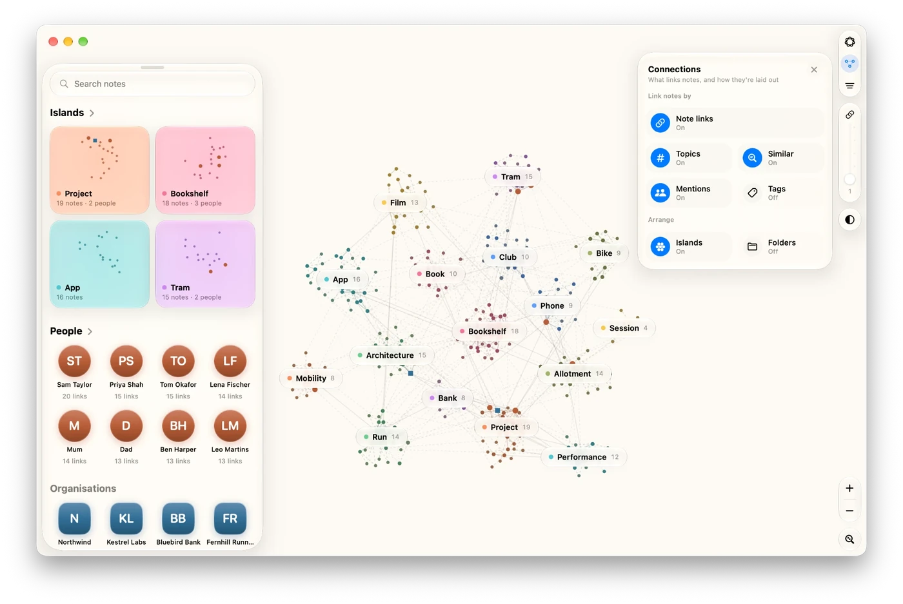
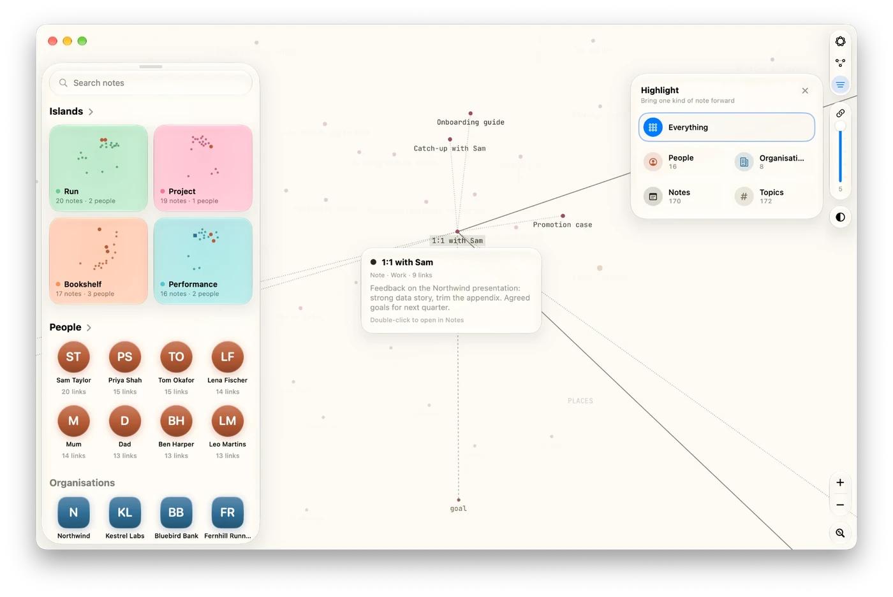
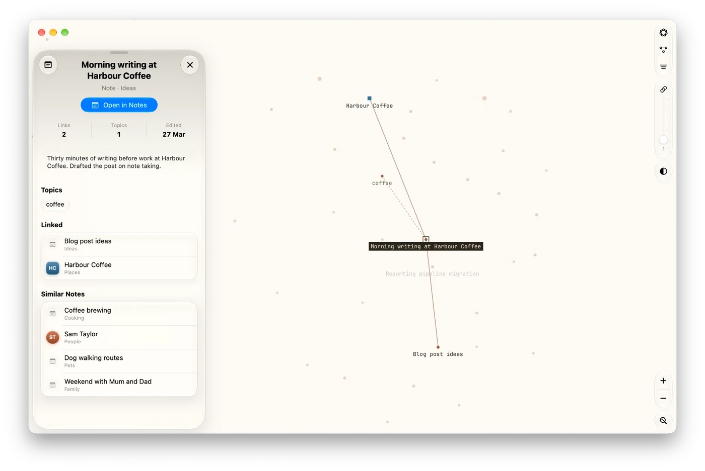
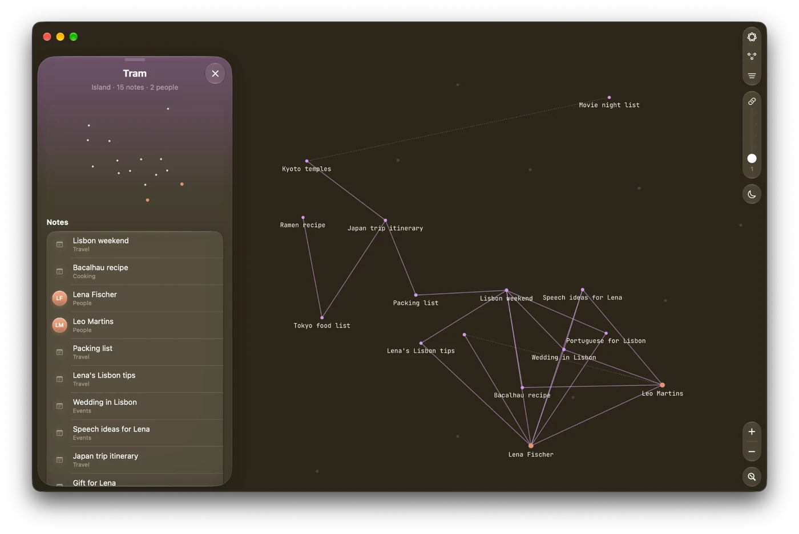
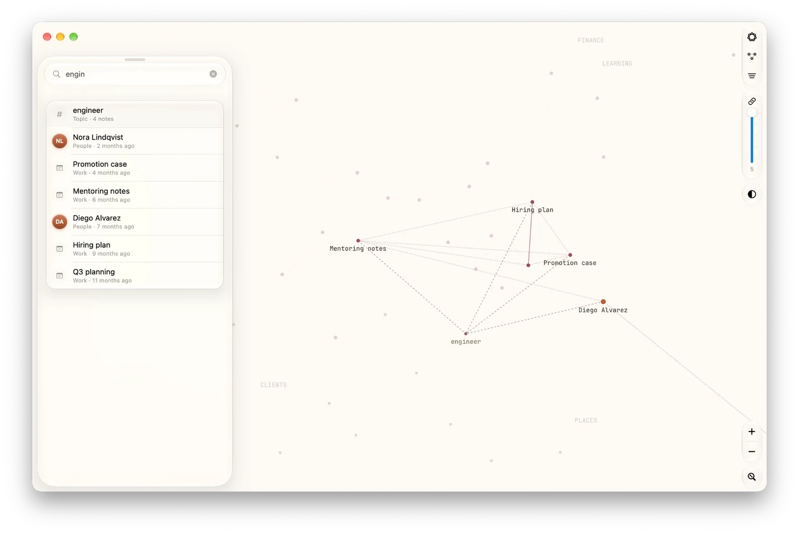

<p align="center">
  
</p>

<h1 align="center">Notes Mesh</h1>

<p align="center">
  
  
  
  <a href="./LICENSE"></a>
</p>

<p align="center">
  <strong>Your Apple Notes as a living map.</strong><br/>
  Notes Mesh reads your Notes library on your Mac and draws it as a graph: islands of related notes, the people and organisations you keep notes about, and the topics that tie them together. Native SwiftUI and Metal, with Liquid Glass controls. Nothing leaves your Mac.
</p>

<p align="center">
  
</p>

<div align="center" style="line-height: 0;">
  <br>
  <br>
  
</div>

<p align="center"><sub>Screenshots show the built-in sample library, not real notes.</sub></p>

## Table of Contents
1. [Features](#features)
2. [Privacy](#privacy)
3. [Guide](#guide)
4. [Using Notes Mesh](#using-notes-mesh)
5. [Project Structure](#project-structure)
6. [How it was made](#how-it-was-made)
7. [Contributing](#contributing)
8. [License](#license)

## Features
- **Islands:** related notes gather into islands (Louvain communities in a Barnes–Hut force layout), each with its own colour across the graph, its card and its page. Zoom out and every island is named with a Liquid Glass pill.
- **People and organisations:** a note titled with just a name ("Sam Taylor", "Acme") is a profile. Every note that mentions that name links to it, and same-titled profiles merge into one node. Tag a note `#person` or `#organisation` to say so yourself.
- **Your note links:** the `>>` links you make between notes in Apple Notes (like Obsidian's `[[links]]`) are drawn as solid lines.
- **Topics:** from Apple Intelligence on Macs that have it, reading notes privately on-device, or from keywords your notes share. Switch between them any time.
- **Similar notes:** word overlap blended with on-device sentence embeddings links notes that talk about the same things.
- **A drawer like Maps:** search (⌘F), islands, people, organisations and topics, and a page for anything you select. Double-click a note (or ⌘↩) to open it in Notes.
- **Fast:** the graph is drawn with Metal as instanced quads. On an M4 Pro it holds 116 fps with an average frame build of 0.32 ms at about 900 nodes and 1,700 edges.
- **Light and dark:** follows your Mac, or pick one with the button under the slider.

## Privacy
Notes Mesh is built to be safe to point at your most personal notes.

- **Nothing leaves your Mac.** There's no network code, no accounts, no analytics and no crash reporting.
- **Read-only.** Notes Mesh copies the Notes database to a temporary folder, reads the copy and deletes it straight away. It never writes to the Notes library, and it skips locked notes.
- **What it keeps:** only what it works out (topics, profile types, similarity vectors, settings) in `~/Library/Application Support/NotesMesh/`. **File → Delete Notes Mesh Data** removes it all.

The full policy is in [PRIVACY.md](PRIVACY.md).

> Notes Mesh is an independent project and isn't affiliated with or endorsed by Apple. It reads the Notes app's private database format, which can change with any macOS update. Apple, Apple Notes and Apple Intelligence are trademarks of Apple Inc.

## Guide

### 1. Requirements
- macOS 26 or later.
- Xcode's Command Line Tools (`xcode-select --install`). No Xcode project needed.
- Apple Intelligence is optional. Without it, or where an organisation has turned it off, topics come from keywords.

### 2. Build and install
```bash
git clone https://github.com/jonothanhunt/notesmesh.git
cd notesmesh
scripts/build-app.sh install
open ~/Applications/Notes Mesh.app
```

The script signs with your Apple Development certificate if you have one, so macOS keeps Notes Mesh's access across rebuilds. Without one it signs ad hoc, and you may need to grant access again after each build.

### 3. Connect your notes
Notes Mesh opens with a sample library so you can explore straight away. The card at the top of the drawer walks you through turning on **Full Disk Access** (System Settings → Privacy & Security), which is the only way macOS lets an app read the Notes library. You can drag Notes Mesh straight into the list. As soon as access is on, your own notes replace the samples.

### 4. Releasing (maintainers)
```bash
xcrun notarytool store-credentials notesmesh --apple-id YOU@EXAMPLE.COM --team-id TEAMID
NOTARY_PROFILE=notesmesh scripts/build-app.sh release
```
This signs with Developer ID, uses the hardened runtime, notarizes, staples and writes `build/NotesMesh.zip` for a GitHub release.

## Using Notes Mesh

| Do this | To |
| ------- | -- |
| Click a node | Focus it and open its page in the drawer |
| Double-click a note, or ⌘↩ | Open it in Notes |
| Zoom out, click a pill | Explore that island |
| ⌘F | Search |
| ⌘K | Quick open |
| Scroll or drag the drawer | Resize it (pill, half, full) |
| ⌘R / ⇧⌘R | Reload notes / rebuild the index |
| Top-right buttons | Apple Intelligence, Connections, Highlight, similar-notes slider, appearance |

Launch options for development: `--sample` shows only the sample library (never your notes), `--diagnostics` writes a diagnostics file, and `--bench` measures rendering speed.

## Project Structure

```text
notesmesh/
├── Sources/NotesMesh/
│   ├── NotesStore.swift, NoteProto.swift        # read the Notes database (temporary copy) and note bodies
│   ├── Intelligence.swift                       # Apple Intelligence, keywords, embeddings, the index cache
│   ├── Category.swift, GraphBuilder.swift       # people/organisation profiles, building the graph
│   ├── Indexer.swift                            # loading, background reading, live reload, deleting data
│   ├── MetalGraphView.swift, GlyphAtlas.swift   # the Metal renderer, labels and island pills
│   ├── ForceSim.swift, Communities.swift, LayoutSetup.swift   # layout and islands
│   ├── Views.swift, Panel.swift, GraphView.swift, App.swift   # SwiftUI: controls, drawer, pages
│   └── DemoLibrary.swift                        # the sample library
├── Resources/      # NotesMesh.icon (Icon Composer), AppIcon.icns, entitlements, privacy manifest
├── Web/fonts/      # JetBrains Mono for graph labels (OFL)
├── scripts/        # build-app.sh
└── assets/         # README images
```

## How it was made

Notes Mesh was designed and directed by Jonothan Hunt and written with AI models as pair programmers, working in [Claude Code](https://claude.com/claude-code).

**Models used to build it**

| Model | Used for |
| ----- | -------- |
| Claude Opus 5.5 (Anthropic) | Code, design iterations, the Metal renderer, the sample library, docs and release work |

**Models inside the app** (all on-device, nothing leaves your Mac)

| Model | Used for |
| ----- | -------- |
| Apple Foundation Models (Apple Intelligence, on-device) | Reading notes for topics and whether a note is a person or organisation profile |
| Apple NaturalLanguage sentence embeddings | Finding similar notes |
| Apple NaturalLanguage tagger | Names, organisations and keyword topics |

## Contributing

Feedback, ideas and PRs are welcome, whether that's a new way to link notes, a layout tweak or a typo. See [CONTRIBUTING.md](CONTRIBUTING.md), and please report security or privacy problems privately as described in [SECURITY.md](SECURITY.md).

## License

MIT © 2026 Jonothan Hunt. See [LICENSE](LICENSE) for the full text. Graph labels use [JetBrains Mono](https://www.jetbrains.com/lp/mono/) under the SIL Open Font License.
